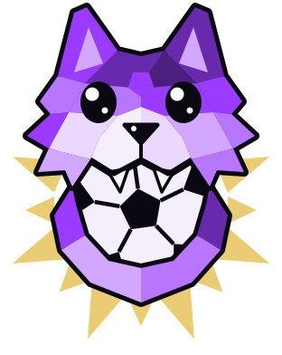

<div align="center">



# GitFutbol

**your GitHub, rated out of 99** ⚽


<br/><br/>

<a href="https://gitfutbol.vercel.app/torvalds"></a>
<a href="https://gitfutbol.vercel.app/ThePrimeagen"></a>
<a href="https://gitfutbol.vercel.app/t3dotgg"></a>

<br/><br/>

**[Scout yourself at gitfutbol.vercel.app](https://gitfutbol.vercel.app)**

</div>

<br/>

## ⚽ &nbsp;What's on the pitch

| | |
|:--|:--|
| **Player cards** | Any GitHub profile as a card rated out of 99, with a position, playstyles and a scout report. |
| **Leaderboard** | Every scouted card ranked, worldwide or by country. It also fills itself daily from GitHub's most-followed developers. |
| **National squads** | The best 25 developers from each country, with a starting XI. |
| **Club mode** | Any GitHub organization as a club, with its own rating and a squad of its top contributors. |
| **Duels** | Put two cards head to head in a stat shootout. |
| **Progression** | Season-by-season ratings, potential and an estimated market value. |
| **Trophies** | A cabinet of awards earned from real GitHub history. |
| **Merge accounts** | Got more than one GitHub account? Combine them into one card. |
| **Re-scout** | Rebuild your card right after a big change, once every 15 minutes. |

<br/>

## 🃏 &nbsp;Embed your card

Your card lives at a URL. Drop it in your profile README or portfolio, and it updates as your stats change.

```md
[](https://gitfutbol.vercel.app/YOUR_USERNAME)
```

| Address | What you get |
|:--|:--|
| `/<username>.png` | your card, as a live image |
| `/<username>` | the full scout report |
| `/<username>/progress` | seasons, potential and market value |
| `/<username>/vs/<opponent>` | a duel |
| `/club/<org>` | an organization as a club |
| `/squads/<country>` | a national squad, such as `/squads/vn` |
| `/leaderboard` | the world rankings |
| `/merge` | combine your accounts |

Add `?country=XX` to a card link to override its flag.

<br/>

## ⚙️ &nbsp;How the scouting works

Each stat is read straight from GitHub's API. No surveys, no self-reporting.

| | Stat | Scouted from |
|:--:|:--|:--|
| **PAC** | Pace | Contributions in the last year |
| **SHO** | Shooting | Stars earned, plus your top repo |
| **PAS** | Passing | Pull requests, plus followers |
| **DRI** | Dribbling | Languages you work in |
| **DEF** | Defending | Reviews, plus issues |
| **PHY** | Physical | Lifetime contributions, plus active years |

**Stats.** Each signal is rated between two anchors on a log scale: nothing scores 40, a typical active developer scores 60, and an elite one scores 99. The card shows those numbers as they are.

**Position.** Your shape picks your archetype. A stat has to stand out at least 5 points above your own average to count, so a card only becomes a specialist when it really is one. Thin or balanced profiles play as Allrounders at CM.

| Archetype | High | Low | Positions |
|:--|:--|:--|:--|
| Playmaker | DRI, PAS | DEF, PHY | RW, SS, CM, CAM |
| Striker | SHO | DEF | ST, CF |
| Anchor | DEF, PHY | SHO | CDM, CB |
| Fullback | PAC | SHO | RWB, RFB |

**Overall.** Stats are weighted by archetype and cap at **88**. The last points are a legacy bonus of up to 11, earned with years and influence, so one heroic year won't crown you an Icon.

Every card walks out in a finish:

<div align="center">


</div>

Around your photo, the **Year Ring** wraps your last 52 weeks around the sun: one ray a week, seven cells deep. Every extra cell takes twice the contributions, and 64+ in a week fills the ray, so no two cards burn the same.

<br/>

## 📈 &nbsp;Progression

A GitHub account ages like a footballer. Your player age is 17 plus your years on GitHub.

- **Seasons** are rebuilt from your yearly GitHub history, one rating per calendar year.
- **Potential** is the highest overall your card is projected to reach by age 29. Younger accounts have more room, up to +15, and you keep more of it the more days you code: 250 active days a year keeps all of it, and none keeps a quarter.
- **Market value** is an estimate built from your overall, your room to grow and your age.

<br/>

## 🔗 &nbsp;Merging accounts

GitFutbol has no logins, so you prove both accounts are yours with a short code. The site gives you one at [`/merge`](https://gitfutbol.vercel.app/merge), you add it to the bio of both accounts, and you remove it once the check passes. Only an account's owner can edit its bio, so nobody can merge an account that isn't theirs.

- Stars, contributions, followers and languages add up on the main account's card.
- The other accounts leave the leaderboard, and their pages redirect to the merged card.
- A main account can take up to 3 others, and the same code check splits them again.

GitHub only gives totals, so a follower of both accounts counts twice.

<br/>

## 🏆 &nbsp;Trophies

Standout cards earn trophies, shown on the scout report and carried into duels. Click one for its story: every win comes with its year or World Cup edition and the reason it was given.

| Award | Won for |
| :---: | :--- |
| **Ballon d'Or** | A calendar year that towers over the rest of your career. Up to 3, and Icons can take a 4th. |
| **WC Golden Ball** | Rising above your own pace while a World Cup ran, from 2010 to 2026. One per edition. |
| **Golden Boot** | Elite Shooting (`SHO` 80+) from an attacking position, held on current form. |
| **World Cup Trophy** | ¡Campeones! Spain won WC26, and every profile located in Spain lifts it. |

<details>
<summary><strong>The full rulebook</strong></summary>

<br/>

Every scout fetches the profile's full history as per-year totals: commits, PRs, reviews, issues and private contributions. Yearly awards are judged on one score per year:

```
yearScore = 4·log(commits) + 3·log(PRs) + 3·log(reviews) + 2·log(issues) + 2·log(private)
```

The logs are the anti-spam mechanism. Each signal saturates: 20,000 commits score 17.2, barely ahead of the 13.2 that 2,000 earn. Meanwhile a year of 800 commits, 80 PRs, 80 reviews and 40 issues scores 26. There is no balance requirement, though: a commits-only kernel maintainer still scores on the volume terms alone.

Every trophy except the Spanish gift also requires **overall 80+**.

#### Ballon d'Or

Judged against your own career, so it needs at least two years of history. A year wins when it clears all three:

1. **2,000+ raw contributions.** No Ballon d'Or on a quiet year.
2. **Score 16+.** Strong in absolute terms, not just relative ones.
3. **One of two paths:**
   - *The spike*: 1.2× your career-median year. One undeniable season in a modest career.
   - *The elite*: score 19.5+, ratio waived. A sustained-great career has a huge median no single year can tower over.

Repeats climb a ladder on the card's overall: **80** holds one, **87** unlocks a second, **94** a third. Icons can take a fourth, only for a monster year (score 28+). The current year competes while still in progress, so nothing is ever awarded on a projection.

#### WC Golden Ball

One per World Cup edition. For candidates (overall 80+, activity in a WC year) the scout fetches contributions inside each tournament window and judges them era-adjusted:

| Edition | Window | The bar |
| :-- | :-- | :-- |
| South Africa 2010 | Jun 11 – Jul 11 | Presence. Shipping on GitHub at all was the distinction. |
| Brazil 2014 | Jun 12 – Jul 13 | A handful of contributions. |
| Russia 2018 | Jun 14 – Jul 15 | A real window, at **1.2×** your usual pace. |
| Qatar 2022 | Nov 20 – Dec 18 | A strong window (~10 contributions/day), at **1.3×** your usual pace. |
| North America 2026 | Jun 11 – Jul 19 | A strong window (~10 contributions/day), at **1.3×** your usual pace. |

The pace test compares your daily rate inside the window to your daily rate across that same year. On a merged card, the windows are read from the main account.

#### Golden Boot

The one trophy held on current form, not kept for life. It's re-judged on every scout: an attacking position (`ST`, `CF`, `RW`, `LW`, `SS` or `CAM`) and Shooting 80+. Lose the form, lose the boot.

#### World Cup Trophy

Every profile whose GitHub location reads Spain lifts it, bronze cards included. It keys off the country GitHub reports, so switching your flag to 🇪🇸 mints nothing.

The whole cabinet is computed at scout time and cached with the card. Duels never award anything.

</details>

<br/>

## 🛠️ &nbsp;Run it yourself

You'll need Node 20+. It runs on a few baked sample profiles with no setup at all:

```bash
git clone https://github.com/HaoPhuc/gitfutbol.git
cd gitfutbol
npm install
npm run dev
```

Then open http://localhost:3000. Add a `.env.local` for live scouting:

| Variable | What it does |
|:--|:--|
| `GITHUB_TOKEN` | Live scouting. A fine-grained, read-only token with no extra permissions is enough. |
| `GITHUB_TOKENS` | Optional. Several comma-separated tokens from different accounts, for a higher rate limit. |
| `REDIS_URL` | Optional for local work, needed in production. Card cache, leaderboard, squads, re-scout limits and merged accounts. |
| `CRON_SECRET` | Unlocks `/api/cron/seed`, the daily leaderboard seeding. Without it the route stays shut. |
| `NEXT_PUBLIC_SITE_URL` | The public address used in share links and printed on cards. Set it to your own, because it defaults to `https://gitfutbol.com`. |
| `NEXT_PUBLIC_UMAMI_SRC`, `NEXT_PUBLIC_UMAMI_WEBSITE_ID` | Optional analytics. The script only loads when both are set. |
| `NEXT_PUBLIC_SENTRY_DSN`, `NEXT_PUBLIC_SENTRY_URL` | Optional error tracking. |

Before opening a PR, run the checks:

```bash
npm run lint
npm test
npm run build
```

**Deploying.** On Vercel, import the repo, add the variables above and connect a Redis database. `vercel.json` schedules the daily seeding. A `Dockerfile` is included for self-hosting.

See [CONTRIBUTING.md](CONTRIBUTING.md) for conventions and [SECURITY.md](SECURITY.md) to report a vulnerability.

<br/>

## 🙌 &nbsp;Credits

GitFutbol is a fork of [GitFut](https://github.com/Younesfdj/gitfut), created by [Younesfdj](https://github.com/Younesfdj) and its contributors, and released under the [MIT License](LICENSE). This fork adds a new rating engine, the leaderboard, national squads, club mode, progression, re-scouting and account merging.

<br/>

<div align="center">

**Built with** Next.js · TypeScript · Tailwind · Redis

**[gitfutbol.vercel.app](https://gitfutbol.vercel.app)** &nbsp;·&nbsp; scout someone today


</div>
